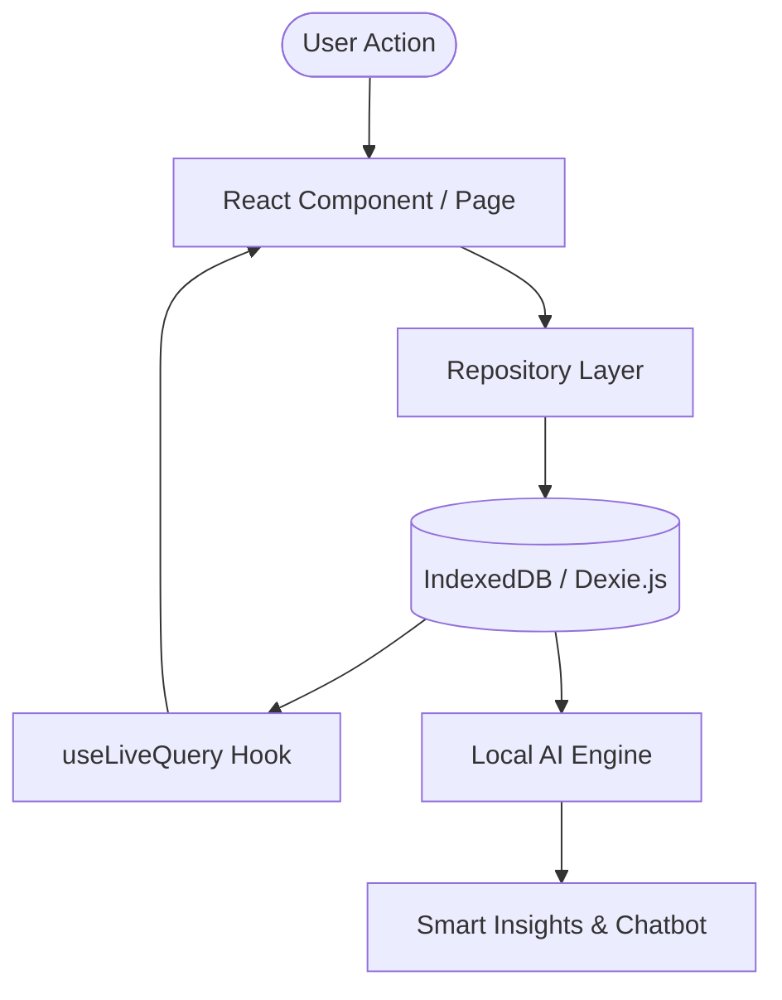

# System Architecture & Technical Specifications

This document outlines the architectural principles, data flow, storage strategies, and component design of the Personal Expense Tracker web application.

---

## 1. Architectural Principles

1. **Local-First & Offline-First**:
   The primary source of truth is the user's local browser storage via **IndexedDB** managed by **Dexie.js**. The application works seamlessly without network connectivity, eliminating cloud latency and privacy risks.

2. **Integer Arithmetic for Financial Precision**:
   All monetary amounts are converted and stored as integers in **minor currency units** (e.g. paise for INR, cents for USD) using `toMinorUnits()` and formatted via `formatCurrency()`. This completely eliminates IEEE-754 floating-point rounding errors.

3. **Layered Decoupled Architecture**:
   - **Persistence Layer**: `src/db/database.ts` and `src/db/repositories.ts` isolate all IndexedDB queries. Components never call Dexie directly.
   - **Reactive Query Layer**: Uses `dexie-react-hooks` (`useLiveQuery`) to automatically trigger React re-renders whenever underlying records are added, modified, or deleted.
   - **Calculation & Domain Utilities**: `src/utils/` encapsulates currency conversion, date formatting, and analytical aggregation.
   - **Local AI Intelligence**: `src/utils/ai-engine.ts` provides on-device rule evaluation, statistical anomaly detection, and natural language question matching without network requests.
   - **Presentation Layer**: Functional React components styled with mobile-first Tailwind CSS.

---

## 2. Database Schema (IndexedDB / Dexie.js)

The database `ExpenseTrackerDB` contains 17 normalized stores:

| Store | Primary Key & Indexes | Description |
|---|---|---|
| `expenses` | `id, date, categoryId, paymentMethodId, eventId, merchant, classification, [date+categoryId]` | Expense transactions |
| `income` | `id, date, categoryId, source, createdAt` | Income entries |
| `expenseCategories` | `id, name, parentId, order, isArchived` | Expense categories |
| `incomeCategories` | `id, name, order, isArchived` | Income categories |
| `paymentMethods` | `id, name, order, isArchived` | Payment modes (Cash, UPI, Cards) |
| `budgets` | `id, period, categoryId, isActive, startDate` | Spending budget limits |
| `events` | `id, name, status, startDate, endDate` | Special events & trips |
| `recurringTransactions` | `id, type, frequency, nextDueDate, isActive` | Recurring subscriptions |
| `financialGoals` | `id, status, targetDate` | Financial savings targets |
| `savingsContributions` | `id, goalId, date` | Deposits made to goals |
| `savingsChallenges` | `id, status, startDate` | Savings challenges |
| `receipts` | `id, expenseId, isProcessed` | Stored receipt images & OCR text |
| `expenseSplits` | `id, expenseId, isSettled` | Bill splits |
| `splitParticipants` | `id, splitId, isSettled` | Split member shares & status |
| `merchants` | `id, name, category` | Aggregated merchant visits |
| `priceRecords` | `id, itemName, date, merchant` | Price comparison history |
| `notifications` | `id, type, isRead, createdAt, priority` | In-app alerts |
| `settings` | `id` | Global user configuration |

---

## 3. Data Flow Diagram

---

## 4. Privacy & Security Model

- **Zero Outbound Transmission**: Financial data never leaves the client device.
- **Safe JSON Sanitization**: Backup restoration rigorously validates schemas before merging.
- **XSS Prevention**: React's JSX escaping guarantees user notes and descriptions are rendered as text rather than raw HTML.
